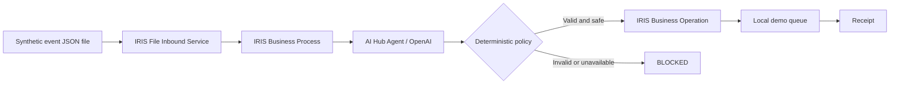

# IRIS Anvil — Agentic Accessibility Interoperability (contest candidate)

**Status:** Native build-154 compiler and fail-closed demonstration validated in an isolated lab (October 17, 2026 UTC). All nine ObjectScript classes compiled after the `Inbox` error-handler repair, all eight deterministic policy cases passed, and `Anvil.Interop.Production` started. **A genuine Grok Build CLI decision has now traversed the native AI Hub Chat interface, deterministic IRIS policy, local outbox/queue and persisted receipt. The earlier canned fixture demonstration remains separately documented.** This interoperability workflow remains separate from the original IRIS Anvil management reactor.

A synthetic household accessibility event enters a real IRIS interoperability **file inbound Business Service**, passes through an **Ens.BusinessProcess**, which calls an **AI Hub %AI.Agent** for a routing proposal, and is independently constrained by a deterministic policy before a **Business Operation** durably queues a *demonstration* delivery. Every successful queued decision receives a SHA-256-based evidence receipt; missing credentials, invalid model outputs, unknown signals and delivery conflicts fail closed.

**Not a live alert system.** Do not connect to real smoke detectors or rely on this sample for emergency communication.

## Pipeline



Signals are `SMOKE`, `BABY_CRY`, `DOORBELL`, `LAUNDRY`. The AI agent proposes `VISUAL`, `HAPTIC`, `BOTH` or `REVIEW`. Smoke and baby-cry signals are **forced to BOTH**, regardless of weaker model proposals. The model has no tools capable of bypassing that rule. No credentials, no decision, no delivery. The demo queue is not a notification service.

## Required image: InterSystems AI Hub Community 2026.3.0AI.154.0

**Do not use 162** for the contest, even if AI Hub public examples describe it. Download `iris-community-2026.3.0AI.154.0-docker.tar.gz` from the [InterSystems AI Hub EAP portal](https://evaluation.intersystems.com/Eval/early-access/AIHub). The image is gated by the EAP portal and must **not** be pushed, rebundled, or redistributed publicly.

After downloading, start from this directory:

```bash
cd contest/ai-hub
export AI_HUB_IMAGE_TAR=/absolute/path/iris-community-2026.3.0AI.154.0-docker.tar.gz
export OPENAI_API_KEY=...   # Your own API key. Never commit it.
./scripts/setup.sh
```

The setup script loads/retags the exact local image and starts `docker compose up -d`; the Compose file deliberately has `pull_policy: never`, localhost-bound ports, and no public image publishing. If your host lacks `setfacl`, ensure `inbox/` and `archive/` grant read/write access to the IRIS container user (UID 51773). Verify image load and port availability before starting.

The workflow uses **OpenAI** via AI Hub's `%AI.Provider`, and reads `OPENAI_API_KEY` from the container environment. Model: `gpt-4o-mini`. No external provider key is embedded in the repository. AI Hub calls will incur API charges; the entry does not bundle free credits. An optional `AI_HUB_OPENAI_BASE_URL` (default unset) can route through a separately configured OpenAI-compatible endpoint. It must end with `/` (build 154 joins relative API paths) and use HTTPS, or `http://127.0.0.1:` loopback inside the IRIS container. Only use a disposable dummy `OPENAI_API_KEY` with locally emulated endpoints; never send a real provider key to an untrusted URL. Deterministic local compatibility tests **by themselves** do not establish real model inference. A separate authenticated Grok Build CLI inference and native AI Hub interoperability run were executed on October 17, using a host-local private Unix-socket bridge.

## Verify and exercise

For build-154 compiler diagnostics **before starting the production**, use the
[controlled runtime validation runbook](RUNTIME-VALIDATION.md). It includes a
compile-only script, local deterministic policy cases, fail-closed log validation,
and clear limits on what the resulting evidence proves. Compile, policy-only, and
no-key/invalid-signal production tests were subsequently executed in an isolated
build-154 runtime. A later isolated Grok CLI inference run also proved native AI Hub Chat → governed local queue/outbox/receipt and idempotent replay. The default OpenAI provider was **not** called; see [Grok bridge runbook](tools/grok/README.md).

```bash
python3 scripts/check_contract.py  # structural checks only; no runtime proof
./scripts/demo.sh               # submit synthetic doorbell event
docker exec -i iris-anvil-aihub iris session iris -U USER < scripts/verify.scr
```

Use [the local IRIS Management Portal](http://127.0.0.1:52783/csp/sys/UtilHome.csp) to inspect `Anvil.Interop.Production` message traces. Also inspect `^Anvil.Interop.Queue` in namespace USER. Try an invalid signal and an absent API key and verify they do **not** produce a queued outcome. Confirm that SMOKE routes to BOTH even if the agent proposes otherwise. The `demo.sh` script writes an event into `inbox/` atomically for the adapter.

**Evidence status:** The isolated local IRIS runtime compiled 9/9 classes, passed 8/8 deterministic policy tests, and started the interoperability production. Synthetic `DOORBELL` without credentials and `UNKNOWN` signal were archived with IRIS response messages reporting `BLOCKED` and the expected reasons. Both resulted in no outbox, queue or receipts. A repeated no-key event was also blocked. Source-level and build-154 test logs remain in the private Butcher lab. A later network-isolated lab test with a **ChatGPT-authored, test-only agent fixture kept outside this repository** produced four queued outcomes and four receipts, including policy-enforced upgrades of SMOKE/BABY_CRY to BOTH. A pending-decision journal was then exercised with interrupted-state simulations: same decision and receipt restored without a new proposal, while orphaned outbox and mismatched-input cases failed closed. This is **not** a live provider-call, real process-crash, production deployment, or external attestation proof. A malformed JSON file remained in the inbox after rejection; handling/quarantine behavior needs a separate operational review.

## Contest and provenance

Official [2026 contest](https://openexchange.intersystems.com/contest/49) runs Oct 26–Nov 15; submit by **Nov 8, 2026**. Entries require a meaningful IRIS AI Hub agent decision in an interoperability workflow, source on GitHub/GitLab, and English installation instructions. This project extends the earlier [IRIS Anvil](../../README.md) management-cockpit work with an original Interoperability production.

References: [AI Hub EAP](https://github.com/intersystems-community/ai-hub-eap), [competition rules](https://community.intersystems.com/post/intersystems-programming-contest-ai-agents-interoperability-workflows).

## Current limitations

- Synthetic events; in-IRIS local queue only; no actual SMS, vibration, lighting, or emergency dispatch.
- Receipt is a digest of canonical input/decision metadata, not an external attestation or an immutable signed receipt. The local demo ledger is not tamper-evident.
- Build-154 compilation, native policy checks, fail-closed live production tests, and fixture-based successful queue/receipt paths are proven. The contest still needs a genuine live AI Hub agent decision, real failure/restart recovery tests, and submission artifacts.
- AI Hub APIs are EAP/pre-release and may differ from the latest public SDK documentation; verify compilation on build 154.


### Process-crash recovery evidence

A separate, **real SIGKILL** of an isolated IRIS worker after delivery acknowledgment
and before receipt persistence retained the pending decision and local outbox.
The unmodified router subsequently reconstructed the receipt using the original
decision after an operator-controlled production restart **and a fresh replay**.
It did **not** automatically retry the first failed message. See the
[worker-crash evidence and read-only recovery audit](CRASH-RECOVERY.md).
No power-loss, unattended worker recovery, or external notification guarantee
is claimed.


### Explicit one-shot replay of interrupted demo events

A separate, optional [supervised recovery operator](tools/recovery/OPERATOR-REPLAY.md)
now supports a **human-approved, fail-closed replay** after a worker crash.
It checks the saved input digest, independent policy, original local Queue
and Outbox, then claims a single replay before atomically staging the
original synthetic JSON through the File Inbound Adapter. It never
asks the AI model for another proposal. This is **not unattended recovery**:
operators must confirm the production was restarted and supply the
original input fingerprint. Failures leave a visible recovery claim for
manual reconciliation; no automatic claim reset is provided.
