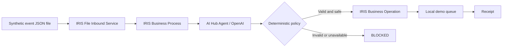

# IRIS Anvil — Agentic Accessibility Interoperability (contest candidate)

**Status:** Implementation candidate; **not yet compiled or run against InterSystems AI Hub 154**. This is a new interoperability workflow separate from the original IRIS Anvil management reactor.

A synthetic household accessibility event enters a real IRIS interoperability **file inbound Business Service**, passes through an **Ens.BusinessProcess**, which calls an **AI Hub %AI.Agent** for a routing proposal, and is independently constrained by a deterministic policy before a **Business Operation** durably queues a *demonstration* delivery. Every successful queued decision receives a SHA-256-based evidence receipt; missing credentials, invalid model outputs, unknown signals and delivery conflicts fail closed.

**Not a live alert system.** Do not connect to real smoke detectors or rely on this sample for emergency communication.

## Pipeline



Signals are `SMOKE`, `BABY_CRY`, `DOORBELL`, `LAUNDRY`. The AI agent proposes `VISUAL`, `HAPTIC`, `BOTH` or `REVIEW`. Smoke and baby-cry signals are **forced to BOTH**, regardless of weaker model proposals. The model has no tools capable of bypassing that rule. No credentials, no decision, no delivery. The demo queue is not a notification service.

## Required image: InterSystems AI Hub Community 2026.3.0AI.154.0

**Do not use 162** for the contest, even if AI Hub public examples describe it. Download `iris-community-2026.3.0AI.154.0-docker.tar.gz` from the [InterSystems AI Hub EAP portal](https://evaluation.intersystems.com/Eval/early-access/AIHub). The image is gated by the EAP portal and must **not** be pushed, rebundled, or redistributed publicly.

After downloading, start from this directory:

```bash
cd contest/ai-hub
export AI_HUB_IMAGE_TAR=/absolute/path/iris-community-2026.3.0AI.154.0-docker.tar.gz
export OPENAI_API_KEY=...   # Your own API key. Never commit it.
./scripts/setup.sh
```

The setup script loads/retags the exact local image and starts `docker compose up -d`; the Compose file deliberately has `pull_policy: never`, localhost-bound ports, and no public image publishing. If your host lacks `setfacl`, ensure `inbox/` and `archive/` grant read/write access to the IRIS container user (UID 51773). Verify image load and port availability before starting.

The workflow uses **OpenAI** via AI Hub's `%AI.Provider`, and reads `OPENAI_API_KEY` from the container environment. Model: `gpt-4o-mini`. No external provider key is embedded in the repository. AI Hub calls will incur API charges; the entry does not bundle free credits.

## Verify and exercise

```bash
python3 scripts/check_contract.py  # structural checks only; no runtime proof
./scripts/demo.sh               # submit synthetic doorbell event
docker exec -i iris-anvil-aihub iris session iris -U USER < scripts/verify.scr
```

Use [the local IRIS Management Portal](http://127.0.0.1:52783/csp/sys/UtilHome.csp) to inspect `Anvil.Interop.Production` message traces. Also inspect `^Anvil.Interop.Queue` in namespace USER. Try an invalid signal and an absent API key and verify they do **not** produce a queued outcome. Confirm that SMOKE routes to BOTH even if the agent proposes otherwise. The `demo.sh` script writes an event into `inbox/` atomically for the adapter.

**Evidence status:** No authenticated AI Hub 154 runtime test has run yet. The standalone static checker cannot prove ObjectScript compiles, the production starts, or the provider call succeeds. Collect compile logs, production message traces, result/receipt output, reject-case proof and a silent demo recording after obtaining the 154 image.

## Contest and provenance

Official [2026 contest](https://openexchange.intersystems.com/contest/49) runs Oct 26–Nov 15; submit by **Nov 8, 2026**. Entries require a meaningful IRIS AI Hub agent decision in an interoperability workflow, source on GitHub/GitLab, and English installation instructions. This project extends the earlier [IRIS Anvil](../../README.md) management-cockpit work with an original Interoperability production.

References: [AI Hub EAP](https://github.com/intersystems-community/ai-hub-eap), [competition rules](https://community.intersystems.com/post/intersystems-programming-contest-ai-agents-interoperability-workflows).

## Current limitations

- Synthetic events; in-IRIS local queue only; no actual SMS, vibration, lighting, or emergency dispatch.
- Receipt is a digest of canonical input/decision metadata, not an external attestation or an immutable signed receipt. The local demo ledger is not tamper-evident.
- Needs exact build 154 image, working provider credentials, and verified execution before contest submission.
- AI Hub APIs are EAP/pre-release and may differ from the latest public SDK documentation; verify compilation on build 154.
