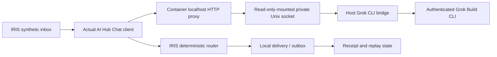

# Optional Grok Build → InterSystems AI Hub bridge

**Purpose:** let IRIS AI Hub 154's actual `%AI.Agent.Chat()` method use a genuine
Grok Build CLI inference response through an isolated local OpenAI-compatible
adapter. This is an operator-run lab component, **not** a production notification
service or a signed WindAnvil assurance system.

The architecture is deliberately asymmetric:



The Grok CLI's credentials stay under the *host user's* `~/.grok`; neither
this repository nor the IRIS container receives those credentials. The model
invocation is tool-disabled, web-search-disabled, noninteractive, restricted to
synthetic allowlisted alert signal types and one turn, with a finite timeout.
The bridge returns a failure response unless the model finishes with **exactly
one** canonical output token: `VISUAL`, `HAPTIC`, `BOTH`, `REVIEW`.
The IRIS `Anvil.Interop.Policy` independently governs that proposal.

## Reproduce (authorized disposable lab only)

Prerequisites: a **working authenticated** `grok` CLI on the Docker host,
locally loaded `iris-ai-hub-community:2026.3.0AI.154.0` image, Python 3.12+,
and a healthy Docker daemon. `grok --single ... --output-format json` must
return a successful result. A paid/model subscription may apply.

Set `ROOT` to the checkout's `contest/ai-hub` directory and `LAB` to a
temporary private directory owned by the operator, not tracked in Git. Keep
synthetic event details free of real names or private home data.

```bash
export ROOT="$PWD/contest/ai-hub"
export LAB="$HOME/lab/iris-grok-proof"
mkdir -p "$LAB/run" "$LAB/clean-cwd" "$LAB/evidence"
chmod 700 "$LAB"
chmod 711 "$LAB/run"  # socket path traversable by Docker; socket itself mode 0600
nohup python3 -u "$ROOT/tools/grok/bridge.py" \
  --socket "$LAB/run/grok.sock" --cwd "$LAB/clean-cwd" \
  --grok-binary "$HOME/.local/bin/grok" \
  > "$LAB/evidence/bridge.log" 2>&1 < /dev/null &
```

Use a fresh local test container with `--network none`, **no published ports**,
`--mount type=bind,src="$ROOT/src",dst=/opt/iris-anvil/src,readonly`,
and `--mount type=bind,src="$LAB/run",dst=/grokbridge,readonly`. Set only
`OPENAI_API_KEY=synthetic-local-bridge` (a dummy, never a real provider token)
and `AI_HUB_OPENAI_BASE_URL=http://127.0.0.1:8389/v1/`. Start the container
with the documented `--check-caps false` image argument.

Inside that isolated container, create `/opt/iris-anvil/inbox` and
`/opt/iris-anvil/archive`, chown both to IRIS UID 51773, copy
`tools/grok/container_proxy.py` to `/tmp/container_proxy.py`, then run
`python3 -u /tmp/container_proxy.py` detached **as container root**. It is
bound to container-only `127.0.0.1:8389` and relays to the mounted socket;
it does not open a host port or access Grok credentials.

Through an authorized IRIS terminal run, in order:
`scripts/compile-only.scr`, `scripts/policy-only.scr`, and
`scripts/install.scr`. Verify their output using
`scripts/verify-runtime-log.py`. Submit one synthetic JSON event through
the File Inbound Adapter and verify the `^Anvil.Interop.Receipts`,
`^Anvil.Interop.Queue`, `^Anvil.Interop.Outbox` and persisted
`Anvil.Interop.Result` records. Repeat the *identical* event ID and payload
in a second file: the receipt must match and the bridge's successful model
call count must **not** increase.

Stop the disposable IRIS container and the host bridge when evidence is
captured. Do not distribute the EAP image or upload provider/session secrets.

## Evidentiary boundary

The October 17, 2026 Butcher run executed the **genuine Grok Build CLI** and
native AI Hub Chat path, with independent host bridge and IRIS record logs.
It proved one synthetic `DOORBELL` routing decision, queue/outbox and
receipt, and idempotent replay. The result was `BOTH`. It was not a real
emergency, external notification, crash-resilience proof, or externally signed
attestation.

The bridge's log contains a SHA-256 of the Grok JSON stdout and the canonical
decision, not authentication secrets. The private raw evidence stays on
Butcher; only code, runbook and non-sensitive proof summaries go to GitHub.
